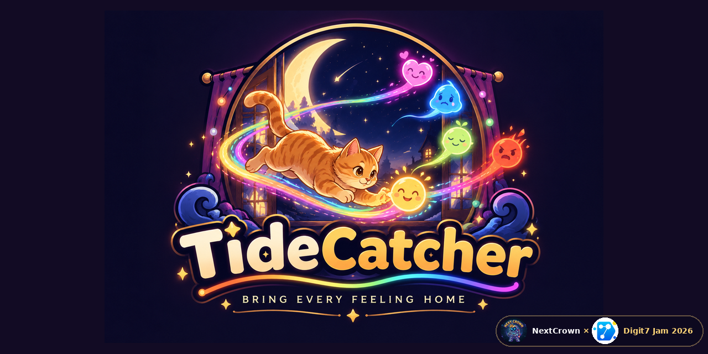

# TideCatcher

TideCatcher is a static browser Canvas game by **NextCrown** for Digit7 Jam 2026. Vercel uses the repository root as its project root; Cloudflare Workers serves the `game/` static assets.

## What's new: the Mood Tide

The game is called TideCatcher because feelings come and go like tides. While Moodlings are loose the **Mood Tide** is high: rain falls, the night turns cool and the edges darken. Every feeling Shwe brings home lowers it, until the sky warms and fireflies come out. A small gauge under the FOUND box shows the tide, coloured by the feeling most still out tonight.

- **Tide pool (Night 6):** a keepsake under the jetty only shows once the tide is low, so the order you calm the night matters. In Gentle mode it is always open.
- **Festival lanterns:** on festival nights every catch sends a paper lantern into the sky, so by the end the sky is full of the lights you brought home.
- **Heights on Nights 1-4:** desks, shelves, the slide, a bench and the stall roofs can now be stood on, each hiding a new keepsake (3 per night).
- **Nights 8-50:** shorter (4,500-6,000 wide), gently rolling ground, a hazard that fits each map on every night, and hide/dig spots that no longer repeat.

## Project structure

```text
game/                       Static game site
  index.html                Game markup and metadata
  css/                      Game and interface styles
  js/                       Game, levels, UI and customization (mood-tide.js: the Mood Tide)
  assets/                   Cat art, scenes, fonts and audio
docs/                       Level notes, design briefs and art proof
tests/                      Game integrity and level layout checks
.github/workflows/          GitHub Actions checks
index.html                  Root entry point for Vercel
TideCatcher.html            Legacy game entry point
wrangler.jsonc              Cloudflare Workers static asset settings
```

The project is a static browser game; gameplay and progress saves run entirely in the browser.

## Run locally

From the repository root, run `python -m http.server 8000` and open `http://localhost:8000/` or `http://localhost:8000/game/`. The root entry forwards to the game. Older `/frontend/` links continue to redirect to the current game path.

## Tests

Run `for f in tests/*.test.js; do node "$f"; done` from the repository root. Every test must pass.

## Adding art

- Put game images in `game/assets/` and refer to them with a relative path (for example `'assets/cats/bengal.png'`). Do not paste images into JS as base64.
- For every new piece of art, add its sketches, progress and final version to `docs/proof/`, and update `AI-DECLARATION.md` if AI was used. See [`docs/proof/README.md`](docs/proof/README.md).
